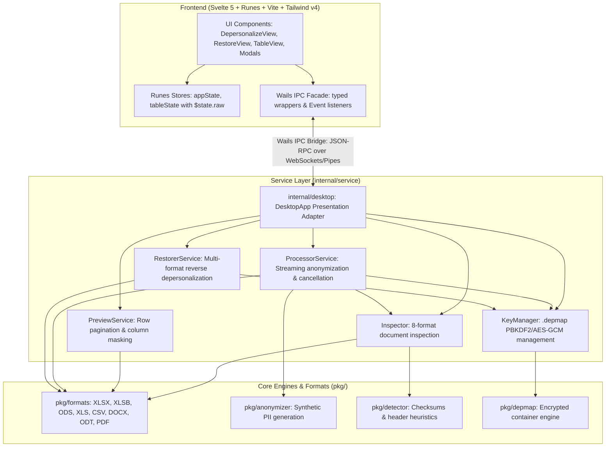

# Архитектура системы: Деперсонализация ПД (152-ФЗ)

Техническое описание архитектуры, алгоритмов, структур данных и криптографических протоколов кроссплатформенного приложения локального обезличивания и обратной персонализации данных.

---

## 1. Архитектурный обзор

Приложение построено на базе фреймворка **Wails v2** и языка **Go (1.23+)** с нативным биндингом к системным движкам WebView (WebKit2GTK в Linux, WebKit/WKWebView в macOS, WebView2 в Windows). 



### Принципы проектирования:
1. **Чистая архитектура (Clean Architecture)**: Полное разделение UI/Wails адаптера (`internal/desktop`), сервисов бизнес-логики (`internal/service`), доменных сущностей (`internal/domain`) и низкоуровневых процессоров (`pkg/`). Любой сервис может быть протестирован автономно без запуска WebView.
2. **Мгновенная отмена (Context Cancellation)**: Долгосрочные операции (потоковое обезличивание, инспекция, восстановление) поддерживают прерывание пользователем в 1 клик через `context.Context` с безопасным закрытием дескрипторов и удалением незавершенных файлов.
3. **Строгий Air-Gapped режим**: Приложение не открывает сетевых слушающих портов наружу, не выполняет внешних HTTP/DNS-запросов и не использует внешние CDN. Все графические ресурсы и стили встроены в исполняемый файл через директиву `//go:embed all:dist`.
4. **Высокая производительность UI**: Использование `$state.raw` в Svelte 5 для коллекций предпросмотра строк исключает оверхед глубокого проксирования на больших объемах данных.
5. **Потоковая обработка (Streaming I/O)**: Обработка больших файлов выполняется чанками и строковыми потоками с низким потреблением оперативной памяти.
6. **Ссылочная целостность (Referential Integrity)**: Синтетические данные генерируются псевдослучайно, но строго детерминировано на основе `HMAC-SHA256(исходное_значение, соль)`.
7. **Неинвазивная обратимость (Reversibility via `.depmap`)**: Обратная персонализация не требует изменения бизнес-логики генераторов; соответствия вычисляются стриминговым сравнением входа и выхода и упаковываются в зашифрованный файл-контейнер.

---

## 2. Компоненты системы

### 2.1. Пакет `pkg/detector` (Распознавание ПДн)
Отвечает за проверку контрольных сумм и синтаксический анализ колонок:
- `ValidateSNILS(cleanDigits string) bool`: Проверка 11-значного СНИЛС по официальному алгоритму модуля 101 с весовыми коэффициентами `[9, 8, 7, 6, 5, 4, 3, 2, 1]`.
- `ValidateINN12(cleanDigits string) bool`: Проверка 12-значного ИНН физического лица по двум контрольным числам с официальными коэффициентами ФНС РФ:
  - $K_{11} = [7, 2, 4, 10, 3, 5, 9, 4, 6, 8] \pmod{11} \pmod{10}$
  - $K_{12} = [3, 7, 2, 4, 10, 3, 5, 9, 4, 6, 8] \pmod{11} \pmod{10}$
- `FindHeaderRow(rows [][]string) (headerIndex int, headers []string)`: Эвристический анализатор шапки таблицы, устойчивый к пустым строкам, метаданным выгрузки и сложным преамбулам.

### 2.2. Пакет `pkg/anonymizer` (Трансформации и синтез)
Отвечает за генерацию реалистичных псевдонимизированных данных:
- **Сохранение пола (Gender Preservation)**: Функция `DetectGender(fio)` анализирует окончания фамилий (`-ов`/`-ова`, `-ев`/`-ева`, `-ин`/`-ина`), имён (`-ий`/`-ия`, `-ей`, `-а`/`-я`) и отчеств (`-ович`/`-овна`, `-евич`/`-евна`). Мужские профили заменяются строго на мужские, женские — на женские.
- **Генерация СНИЛС (`GenerateSNILS`)**: Формирует 9 псевдослучайных цифр и динамически рассчитывает корректный двухзначный остаток контрольной суммы.
- **Генерация ИНН (`GenerateINN12`)**: Формирует 10 цифр и рассчитывает обе контрольные суммы для 11-го и 12-го разрядов.
- **Генерация карт «МИР» (`GenerateCardMIR`)**: Генерирует 16-значный номер карты с национальным префиксом `2200`, удовлетворяющий алгоритму Луна (Luhn mod 10).
- **Сдвиг дат (`PerturbDate`)**: Смещает дату рождения в диапазоне $\pm N$ дней с сохранением года или реалистичного возрастного интервала.

### 2.3. Пакет `pkg/depmap` (Криптоконтейнер `.depmap`)
Обеспечивает безопасное хранение словаря соответствий деперсонализации для выполнения обратной операции.

#### Структура бинарного файла `.depmap`:
```
+------------------+------------------+------------------+-----------------------------+
| Magic (8 байт)   | KDF Salt (16 б.) | GCM Nonce (12 б.)| Encrypted Ciphertext + Tag  |
| "DEPMAP01"       | crypto/rand      | crypto/rand      | (AES-256-GCM + ZLIB JSON)   |
+------------------+------------------+------------------+-----------------------------+
```

1. **Заголовок (Magic)**: 8 байт `DEPMAP01` для строгой идентификации типа файла и версии протокола.
2. **KDF Salt**: 16 криптографически стойких случайных байт (`crypto/rand`).
3. **GCM Nonce**: 12 уникальных байт инициализирующего вектора для режима Galois/Counter Mode.
4. **Формирование ключа шифрования**:
   $$\text{Key} = \text{PBKDF2}(\text{password}, \text{salt}, 100\,000, 32, \text{SHA256})$$
   Если пользователь не задал пароль, используется встроенный мастер-секрет приложения, деривированный с уникальной солью конкретного файла.
5. **Тело контейнера**:
   - Словарь замен сериализуется в JSON:
     ```json
     {
       "version": "1.0",
       "created_at": "2026-09-30T12:00:00Z",
       "original_file": "clients.xlsx",
       "records_count": 1420,
       "mappings": {
         "Иванов Иван Иванович": "Смирнов Алексей Петрович",
         "112-233-445 95": "451-892-104 33"
       }
     }
     ```
   - JSON сжимается алгоритмом `zlib` (максимальное сжатие).
   - Сжатые данные шифруются **AES-256-GCM** с добавлением 16-байтового имитовставки (Auth Tag).
6. **Права доступа**: Файл создаётся с маской разрешений `0600` (`-rw-------`), запрещая чтение другим пользователям операционной системы.

### 2.4. Пакет `pkg/formats` (Форматные процессоры)

#### Обработка и восстановление Excel (`excel_handler.go`, `restore_excel.go`)
- Построена на базе высокопроизводительной библиотеки `github.com/xuri/excelize/v2`.
- В режиме деперсонализации используется потоковый интерфейс `StreamWriter` для минимизации аллокаций памяти.
- В режиме восстановления (`RestoreExcel`) файл открывается по листам:
  - Итератор `GetRows` считывает ячейки.
  - Изменения накапливаются в структуре `[]cellChange{Cell: "B12", Value: "..."}`.
  - Применение изменений через `SetCellValue` выполняется после закрытия курсора чтения, что гарантирует сохранение формул, ширины колонок, стилей и структуры книги.
  - **Любые дополнительные столбцы** (добавленные ML-инженерами или подрядчиками: `Score`, `Cluster`) остаются нетронутыми.

#### Обработка и восстановление CSV (`csv_handler.go`, `restore_csv.go`)
- Автоматически распознаёт разделители: `,` (запятая), `;` (точка с запятой), `\t` (табуляция).
- Поддерживает прозрачную очистку UTF-8 BOM (`\xef\xbb\xbf`) и сохранение формата кавычек.
- Потоковое чтение и запись через буферизованный ввод-вывод (`bufio.Reader`, `bufio.Writer`).

#### Вымарывание в PDF (`pdf_handler.go`)
- Алгоритм **Blackout Redaction**:
  - Распаковывает сжатые контентные потоки FlateDecode (`/Filter /FlateDecode`).
  - Парсит операторы вывода текста PDF: `Tj`, `TJ`, `'`, `"`.
  - Заменяет чувствительные текстовые токены на пробельные последовательности фиксированной длины (физическое стирание).
  - Инжектирует векторные графические операторы отрисовки непрозрачных черных прямоугольников (`re`, `f*`, `0 0 0 rg`) с маркером `[ ПДн СКРЫТО ]`.
  - Пересчитывает таблицу перекрёстных ссылок (`xref`) и трейлер документа.

---

## 3. Взаимодействие компонентов (IPC Wails)

Связь между фронтендом Svelte 5 и адаптером Go осуществляется через типизированный фасад `frontend/src/lib/api/wails.ts` и IPC-мост Wails:

| Метод Wails Go | Аргументы | Назначение |
|---|---|---|
| `GetAppInfo` | `()` | Возвращает ОС (`macOS`, `ALT Linux 10.4`, `Windows`), архитектуру и версию |
| `SelectFile` | `()` | Открывает нативный системный диалог выбора документов (все 8 форматов) |
| `SelectKeyFile` | `()` | Открывает системный диалог выбора файлов-ключей (`*.depmap`) |
| `SaveFileDialog` | `(defaultName)` | Открывает диалог сохранения обработанного документа |
| `SaveKeyFileDialog` | `(defaultName)` | Открывает диалог сохранения ключа восстановления `.depmap` |
| `InspectFile` | `(path)` | Анализирует структуру файла, находит шапку и категории ПДн |
| `GetTableRows` | `(path, offset, limit, salt, disabledCols)` | Динамическая подгрузка строк для бесконечного скролла таблицы |
| `GetSheetRows` | `(path, sheet, offset, limit, salt, disabledCols)` | Подгрузка строк конкретного листа многостраничной книги |
| `ProcessFile` | `(path, salt)` | Быстрое обезличивание в файл по умолчанию |
| `ProcessFileTo` | `(path, outPath, salt, disabledCols, createKey, password, keyPath)` | Обезличивание с выборочным исключением колонок и ключом |
| `ProcessFileWithSheets` | `(path, outPath, salt, disabledCols, disabledBySheet, createKey, password, keyPath)` | Пакетное обезличивание многостраничных книг с раздельными колонками |
| `CancelCurrentOperation` | `()` | **Мгновенная отмена текущей операции** (потока деперсонализации или восстановления) |
| `InspectKeyFile` | `(keyPath, password)` | Проверка валидности контейнера `.depmap` и чтение метаданных |
| `RestoreFileTo` | `(inputPath, keyPath, password, destPath)` | Обратная персонализация документа по ключу `.depmap` |
| `OpenContainingFolder` | `(path)` | Открывает папку с файлом в Finder / Explorer / Nautilus |

### События (Wails Events):
- `process-progress`: `{ "processed": 1500, "total": 8500, "percent": 17 }`
- `restore-progress`: `{ "processed": 320, "total": 1420, "percent": 22 }`
- `app:file-dropped`: Эмитится при перетаскивании файла из операционной системы в окно программы (с автоматическим определением режима).

---

## 4. Сборка под различные платформы

Процесс кросс-компиляции описан в `Makefile`:

### 1. Alt Linux 10.4 (Docker)
```bash
make build-altlinux
```
Использует контейнер `alt:p10` архитектуры `linux/amd64` с нативно установленными пакетами `gcc`, `golang`, `libwebkit2gtk-devel`, `libgtk+3-devel`. Гарантирует привязку к системной `glibc 2.32` отечественного дистрибутива.

### 2. macOS Universal Binary
```bash
make build-macos
```
Собирает две независимые версии (`darwin/arm64` под Apple Silicon и `darwin/amd64` под Intel) с флагами связывания `-framework UniformTypeIdentifiers`, после чего объединяет их через утилиту `lipo -create` в единый универсальный файл.

### 3. Windows x86_64
```bash
make build-windows
```
Использует кросс-компиляцию Go (`GOOS=windows GOARCH=amd64`) с флагом `-H windowsgui` для подавления окна командной строки при запуске GUI.

---

## 5. Архитектура UI на Svelte 5 (Runes) и рендеринг таблиц

Интерфейс приложения построен на **Svelte 5** с использованием системы рун (**Runes**):

### 5.1 Реактивное состояние больших данных (`$state.raw`)
Для эффективной работы с электронными таблицами объемом в десятки тысяч строк стандартное глубокое реактивное оборачивание (Deep Proxy) неприемлемо из-за оверхеда по памяти и скорости.
- В `frontend/src/lib/stores/tableState.svelte.ts` массив строк хранится в руне `$state.raw<PreviewRow[]>`:
  - Мутации строк происходят без проксирования отдельных ячеек.
  - При подгрузке новых порций создается новый массив (`rows = [...rows, ...newRows]`), что гарантирует атомарный и высокоскоростной рендеринг.
- Служебное состояние (ширины колонок, флаги загрузки, пагинация, активный лист) управляется рунами `$state`:
  - `columnWidths = $state<Record<number, number>>({})` хранит текущие ширины столбцов в пикселях.
  - `hasMoreRows = $derived(rows.length < totalRows)` вычисляет доступность дальнейших страниц.

### 5.2 Интерактивный ресайз колонок и фиксированная верстка
Для предсказуемого отображения таблицы при любых объемах данных и текста в ячейках:
- Применена фиксированная верстка таблицы `.resizable-table` (`table-layout: fixed; width: 100%`).
- Ширины колонок задаются через `<col>` теги в блоке `<colgroup>` на основе карты `columnWidths`.
- При первой загрузке файла ширины автоматически рассчитываются под длину текста заголовка и бейджей замены с учетом минимальной границы (110–130px).
- Интерактивный разделитель `.col-resizer` перехватывает события мыши (`pointerdown`, `pointermove`, `pointerup` с `setPointerCapture`), гарантируя плавное перетаскивание даже за пределами заголовка таблицы.
- Текст ячеек снабжен обрезкой с многоточием (`truncate`), что позволяет сжимать столбцы до компактных размеров без поломки соседних ячеек.

### 5.3 Динамический бесконечный скролл (Infinite Scroll)
В модальном окне полноэкранного предпросмотра:
- При достижении скроллом нижней границы контейнера (порог 60px) триггерится метод `loadMoreRows()`.
- Строки запрашиваются у бэкенда порциями по 30 штук (`GetTableRows` / `GetSheetRows`).
- Внедрен флаг `loadingMoreRows` для защиты от параллельных или повторных вызовов во время сетевого ожидания.

---

## 6. Подсистема версионирования (Semantic Versioning)

В приложении используется идиоматичный для экосистемы Go подход к версионированию:

### 6.1 Единый источник правды
- Версия определяется в пакете `internal/version/version.go`:
  ```go
  package version

  const Version = "1.1.0"
  ```
- Метод `GetAppInfo()` возвращает `v + version.Version`, отображаемый в шапке `Header.svelte`.
- Версия синхронизирована с `frontend/package.json` и `Makefile`.

### 6.2 Семантическое версионирование (SemVer)
- **PATCH (`X.Y.Z+1`)**: исправление ошибок, точечные правки стилей, текстовые фиксы.
- **MINOR (`X.Y+1.0`)**: новые возможности, новые форматы файлов, переработка экранов UI, оптимизация производительности (текущий релиз `1.1.0`).
- **MAJOR (`X+1.0.0`)**: несовместимые изменения формата контейнера `.depmap` или фундаментальные изменения протоколов.

### 6.3 Журнал изменений (`CHANGELOG.md`)
Все изменения документируются в соответствии с [Keep a Changelog 1.0.0](https://keepachangelog.com/ru/1.0.0/) в файле `CHANGELOG.md`. Обязательные правила для агентов зафиксированы в `AGENTS.md`.
