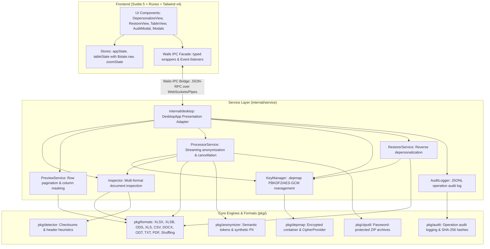

# Архитектура системы: Деперсонализация ПД (152-ФЗ РФ)

Техническое описание архитектуры, алгоритмов, структур данных и криптографических протоколов кроссплатформенного приложения локального обезличивания и обратного восстановления (деобезличивания) данных в соответствии с требованиями Федерального закона № 152-ФЗ «О персональных данных» и Приказа Роскомнадзора от 19.06.2025 № 140.

---

## 1. Архитектурный обзор

Приложение построено на базе фреймворка **Wails v2** и языка **Go (1.25+)** с нативной интеграцией системных компонентов WebView (WebKit2GTK в Linux, WebKit/WKWebView в macOS, WebView2 в Windows). Фронтенд реализован на **Svelte 5** с системой рун (Runes), сборщиком **Vite 6** и стилизацией на **Tailwind v4**.



### Принципы проектирования

1. **Чистая архитектура (Clean Architecture)**:
   - Полная изоляция UI-адаптера (`internal/desktop`), сервисов бизнес-логики (`internal/service`), доменных моделей (`internal/domain`) и низкоуровневых модулей (`pkg/`). Любой сервис может быть покрыт модульными тестами без запуска графической подсистемы.
2. **Мгновенная отмена операций (Context Cancellation)**:
   - Длительные операции (потоковое обезличивание, инспектирование тяжелых файлов, восстановление) поддерживают прерывание через `context.Context` с гарантированным закрытием файловых дескрипторов и безопасным удалением незавершенных временных файлов.
3. **Строгий Air-Gapped режим**:
   - Приложение полностью автономно, не открывает сетевых портов наружу, не выполняет внешних HTTP/DNS-запросов и не использует внешние CDN. Все статические ресурсы и стили встраиваются в исполняемый файл через директиву `//go:embed all:dist`.
4. **Оптимизация производительности UI**:
   - Использование `$state.raw` в Svelte 5 для коллекций строк предпросмотра исключает оверхед глубокого проксирования на больших объемах данных.
5. **Потоковая обработка и контроль памяти**:
   - Обработка таблиц XLSX, XLSB, XLS и CSV выполняется с использованием строковых потоков (включая `excelize.StreamWriter` и буферизованный ввод-вывод) с минимальным потреблением оперативной памяти. Для таблиц ODS распаковка и разбор `content.xml` выполняются в памяти, поэтому фактическое потребление зависит от размера файла. По завершении операций принудительно вызываются `runtime.GC()` и `debug.FreeOSMemory()`.
6. **Ссылочная целостность (Referential Integrity)**:
   - Синтетические данные генерируются псевдослучайно, но строго детерминировано на основе `HMAC-SHA256(исходное_значение, соль)`.
7. **Нормативное соответствие Приказу РКН № 140**:
   - Автоматическая фиксация каждой операции деперсонализации и деобезличивания с расчетом хэшей SHA-256 в структурированном локальном журнале `audit.jsonl`.
   - Поддержка метода криптостойкого перемешивания строк (Shuffling, п. 13) для предотвращения косвенной деанонимизации.
   - Обязательное шифрование контейнеров `.depmap` стойким паролем.
8. **Три стратегии обработки**:
   - `StrategySemanticTokens` (DLP-Safe токены для нейросетей, по умолчанию).
   - `StrategySynthetic` (синтетическая псевдонимизация со ссылочной целостностью).
   - `StrategyDelete` (гарантированное замещение маркером `[УДАЛЕНО]`).
9. **Бескоординатное восстановление (Coordinate-Free Restoration)**:
   - Точное обратное восстановление данных даже при перемешивании порядка строк нейросетью или включении токенов в текстовые выводы LLM (`«Премировать [ФИО_0001]»` $\rightarrow$ `«Премировать Иванов Иван Иванович»`).
10. **Кросс-форматность (10 форматов)**:
    - Поддержка таблиц `.xlsx`, `.xlsb`, `.ods`, `.xods` («МойОфис»), `.xls` (BIFF8), `.csv`, `.tsv`, документов `.docx`, `.odt`, `.txt` и `.pdf`.
11. **Fail-Safe защита памяти для PDF**:
    - Контроль размера входящих PDF-файлов (`MaxPDFInteractiveFileSize = 100 MB`) и ограничение на распаковку потоков (`io.LimitReader` 20 МБ) для предотвращения OOM-сбоев при Base64-сериализации. Для таблиц и текстов искусственные ограничения сняты благодаря потоковой обработке.
12. **Универсальные защищённые ZIP-архивы для email-отправки**:
    - Опциональная упаковка деперсонализированного документа в архив `.zip` со стандартным шифрованием PKWARE (`zip.StandardEncryption` / ZipCrypto) для нативной распаковки штатным проводником любой ОС без сторонних утилит.

---

## 2. Модули системы (`pkg/`)

### 2.1. Модуль распознавания ПДн (`pkg/detector`)
Выполняет валидацию контрольных сумм, синтаксический анализ сущностей и поиск ПДн в неструктурированном тексте:
- `FindTextMatches(text string) []TextMatch`: единый канонический модуль распознавания ПДн в свободном тексте (PDF, DOCX, ODT, TXT, инспектор документов) с фильтрацией наложений, проверкой контекстных маркеров и стоп-слов.
- `ValidateSNILS(cleanDigits string) bool`: проверка 11-значного СНИЛС по официальному алгоритму модуля 101.
- `ValidateINN12(cleanDigits string) bool`: проверка 12-значного ИНН физического лица по двум контрольным числам ФНС РФ.
- `ValidateCardNumber(text string) bool`: проверка номеров банковских карт (13, 15, 16, 18, 19 цифр) с верификацией IIN/BIN префиксов платёжных систем («МИР», Visa, Mastercard/Maestro, UnionPay, American Express) и алгоритма Луна.
- `CleanDigits(s string) string`: единая функция извлечения десятичных цифр из строк.
- `DetectColumnTypeWithSamples(header string, samples []string)`: комбинированный анализ заголовков и содержимого ячеек для надежной классификации сущностей: ФИО (включая «Участник», «Кандидат», плейсхолдеры «ФИО1» и раздельные Фамилия, Имя, Отчество), Адрес, СНИЛС, ИНН (со строгой проверкой границ слов во избежание ложных срабатываний на «инновации» и «инноватор»), Паспорт, Телефон, Банковская карта, Email, Табельный номер, Грейд, Дата (с поддержкой меток времени и защитой от ложных срабатываний на фразах компетенций со словом «сроки»).

### 2.2. Модуль синтеза и токенизации (`pkg/anonymizer`)
Отвечает за генерацию псевдонимизированных данных и семантических токенов:
- **Сохранение пола (Gender Preservation)**: `DetectGender(text)` анализирует морфологические окончания составных ФИО и отдельных компонентов (`-ов`/`-ова`, `-ин`/`-ина`, `-ович`/`-овна`).
- **Генераторы компонентов ФИО**: `GenerateFIO`, `GenerateLastName`, `GenerateFirstName`, `GeneratePatronymic`.
- **Генераторы документов и реквизитов**:
  - `GenerateSNILS`: расчет корректного двухзначного остатка по модулю 101.
  - `GenerateINN12`: расчет обеих контрольных сумм для 11-го и 12-го разрядов.
  - `GenerateCardMIR`: номер карты с префиксом `2200` и валидным алгоритмом Луна.
  - `GenerateAddress`, `GenerateGrade`, `GenerateEmployeeID`, `PerturbDate`.
- **Семантическая токенизация (`TokenSession`)**:
  - Генерация стабильных типизированных токенов `[ФИО_0001]`, `[СНИЛС_0001]`, `[Паспорт_0001]`.
  - Обеспечение однозначного двустороннего сопоставления между исходными значениями и токенами внутри сессии.

### 2.3. Криптоконтейнер ключа (`pkg/depmap`)
Обеспечивает защищенное хранение словаря соответствий для обратного деобезличивания.

#### Структура бинарного файла `.depmap`:
```
+------------------+------------------+------------------+-----------------------------+
| Magic (8 байт)   | KDF Salt (16 б.) | GCM Nonce (12 б.)| Encrypted Ciphertext + Tag  |
| "DEPMAP01"       | crypto/rand      | crypto/rand      | (AES-256-GCM + ZLIB JSON)   |
+------------------+------------------+------------------+-----------------------------+
```

1. **Заголовок (Magic)**: 8 байт `DEPMAP01` для идентификации формата.
2. **KDF Salt**: 16 криптографически стойких случайных байт (`crypto/rand`).
3. **GCM Nonce**: 12 байт вектора инициализации для Galois/Counter Mode.
4. **Криптопровайдер `CipherProvider` (`AES256GCMProvider`)**:
   - Формирование ключа: $\text{Key} = \text{PBKDF2}(\text{password}, \text{salt}, 100\,000, 32, \text{SHA256})$.
   - Шифрование: **AES-256-GCM** с 16-байтовой имитовставкой (AEAD).
5. **Политика надежности паролей (`pkg/depmap/policy.go`)**:
   - Длина не менее 12 символов;
   - 4 обязательных класса символов латиницы: заглавные (`A–Z`), строчные (`a–z`), цифры (`0–9`), спецсимволы (`!@#$%^&*()_+-=[]{}|;:,.<>?`);
   - Исключение кириллицы и пробелов во избежание опечаток и проблем с раскладками клавиатуры.
6. **Тело контейнера**:
   - Сериализуется в JSON со сжатием `zlib` (максимальная компрессия):
     - `mode`: стратегия операции (`"tokens"`, `"replace"`, `"delete"`).
     - `mapping`: словарь соответствий `токен / синтетическое_значение -> исходное`.
     - `cell_mappings`: ассоциативный массив координат `"{Sheet}:{Header}:{PhysicalRow}" -> исходное` для режима удаления в таблицах.
     - `target_headers`: срез канонических имен колонок для **Header-Aware** сопоставления.
     - `ordinal_mappings`: упорядоченный список исходных сущностей для текстовых документов в режиме удаления.
7. **Права доступа**: файл создается с маской разрешений `0600` (`-rw-------`).

### 2.4. Обработчики форматов (`pkg/formats`)

#### Электронные таблицы (`excel_handler.go`, `xls_handler.go`, `xlsb_handler.go`, `ods_handler.go`, `csv_handler.go`, `header.go`)
- **Эвристический анализ шапок таблицы (`header.go`)**:
  - `FindHeaderRow(rows [][]string) (int, []string)`: поиск основной строки заголовков с устойчивостью к преамбулам, отчетам и пустым строкам.
  - `DetectHeaderBounds(rows [][]string, merges []ExcelMergeRange) HeaderBounds`: расчет вертикальных границ таблицы (начало категорий `HeaderStartIdx`, строка листовых заголовков `LeafHeaderIdx`, начало строк данных `DataStartIdx`) с автоматическим определением и пропуском служебных строк нумерации колонок (ГОСТ 2.105, 1С:Предприятие, SAP).
  - `BuildHierarchicalHeaders(rows [][]string, leafHeaderIdx int, merges []ExcelMergeRange) []string`: построение единого иерархического пути («Категория / Подкатегория / Колонка») для многоуровневых шапок с учетом объединений ячеек и автоматической дедупликацией повторяющихся путей.
- **Потоковая запись**: использование `StreamWriter` для минимизации аллокаций памяти.
- **Поддержка многоуровневых шапок и объединений ячеек**: сохранение 100% областей объединения ячеек (`GetMergeCells` -> `sw.MergeCell`) исходного листа при потоковой записи XLSX и обратном восстановлении.
- **Поддержка XLS и XLSB**: обработчики интегрированы с механизмом `ProcessCellWithStrategy` и сессией `TokenSession`, обеспечивая создание семантических токенов и перемешивание строк аналогично современному `.xlsx`.
- **Бескоординатное и независимое от структуры колонок восстановление**: при добавлении внешними нейросетями (LLM) или аналитиками новых колонок, перемещении, переименовании столбцов или включении токенов в текстовые комментарии (например, `Вывод LLM: [ФИО_0001]`), токены формата `[Тип_ID]` безошибочно заменяются на исходные ПДн на уровне каждой ячейки без жесткой привязки к названиям или порядку колонок.
- **Сохранение формул и колонок подрядчиков**: новые колонки (`Score`, `Cluster`, `AI_Summary`), добавленные аналитиками, сохраняются в полном объеме.
- **Перемешивание строк (`shuffle.go`)**: реализация алгоритма Фишера-Йетса с криптостойким генератором случайных чисел (`crypto/rand`) в соответствии с п. 13 Приказа РКН № 140.

#### Текстовые документы (`docx_handler.go`, `odt_handler.go`, `txt_handler.go`)
- Преодоление фрагментации тегов (run-splitting) в абзацах и ячейках таблиц Word и ODT.
- Сохранение типографики: атрибуты шрифтов, цветов, выравнивания параграфов и структуры таблиц сохраняются без изменений.
- Порядковое восстановление (`OrdinalMappings`) для режима удаления.

#### Документы PDF (`pdf_handler.go`)
- **Постраничный предпросмотр**: рендеринг через автономный локальный движок Mozilla `pdfjs-dist` с извлечением нормализованного текстового слоя (устранение проблем составных шрифтов `/Identity-H` и кернинга).
- **Гарантированное физическое вымарывание (Blackout Redaction)**:
  - Наложение аппаратных непрозрачных векторных прямоугольников (`q 0 0 0 rg X Y W H re f Q`) по физическим координатам активных плашек.
  - Физическое удаление текста текстовых контентных потоков под плашками (замена на пробельные глифы CID), исключающее выделение и копирование текстовых операторов. Для сканированных документов с растровыми подложками накладывается визуальная плашка, однако пиксели растровых изображений (XObject Image) не подвергаются попиксельной модификации.
  - Процесс необратим, файл-ключ `.depmap` для PDF не формируется.

### 2.5. Журнал учета операций (`pkg/audit`)
Обеспечивает непрерывный учет процедур в соответствии с Приказом РКН № 140:
- Локальная дозапись в структурированный файл `~/.depersonalizer/audit.jsonl` (JSON Lines).
- Расчет криптографических контрольных сумм **SHA-256** исходного и результирующего файлов.
- Фиксация меток времени (RFC3339), типа операции, режима, путей к файлам, числа записей и статуса.
- Методы `ReadRecent(limit)` для чтения записей и `ExportTo(destPath)` для предоставления реестра регуляторам.

### 2.6. Защищённые паролем ZIP-архивы (`pkg/ziputil`)
- Формирование архивов со стандартным шифрованием PKWARE (`zip.StandardEncryption` / ZipCrypto) для нативной распаковки в проводнике Windows, macOS Archive Utility и Linux `unzip` без стороннего ПО.
- Атомарное создание через временный файл `.tmp` с поддержкой отмены через `context.Context`.
- В архив упаковывается исключительно сам файл данных; файл-ключ `.depmap` в архив не включается.

---

## 3. Взаимодействие компонентов (IPC Wails)

Связь между фронтендом Svelte 5 и Go-бэкендом осуществляется через типизированный фасад `frontend/src/lib/api/wails.ts` и мост Wails:

| Метод Wails Go | Аргументы | Назначение |
|---|---|---|
| `GetAppInfo` | `()` | Возвращает ОС (`macOS`, `ALT Linux 10.4`, `Windows`), архитектуру и версию |
| `SelectFile` | `()` | Системный диалог выбора документов (все 10 форматов) |
| `SelectKeyFile` | `()` | Системный диалог выбора файлов-ключей (`*.depmap`) |
| `SaveFileDialog` | `(defaultName)` | Системный диалог сохранения обработанного документа |
| `SaveKeyFileDialog` | `(defaultName)` | Системный диалог сохранения ключа `.depmap` |
| `SaveArchiveFileDialog` | `(defaultName)` | Системный диалог сохранения ZIP-архива |
| `InspectFile` | `(path)` | Анализирует структуру файла, находит шапку и категории ПДн |
| `GetTableRows` | `(path, offset, limit, salt, disabledCols)` | Постраничная подгрузка строк для бесконечного скролла таблицы |
| `GetSheetRows` | `(path, sheet, offset, limit, salt, disabledCols, mode)` | Постраничная подгрузка строк конкретного листа |
| `ProcessFile` | `(path, salt, mode...)` | Быстрое обезличивание рядом с исходным файлом |
| `ProcessFileTo` | `(path, outPath, salt, disabledCols, createKey, password, keyPath, shuffleRows, mode...)` | Обезличивание с расширенными параметрами |
| `ProcessFileWithSheets` | `(path, outPath, salt, disabledCols, disabledBySheet, createKey, password, keyPath, shuffleRows, mode...)` | Пакетное обезличивание многостраничных книг |
| `ProcessFileWithOptions` | `(options)` | Обезличивание с полной структурой опций (ZIP-архив, рамки PDF) |
| `GetFileBase64` | `(path)` | Безопасное чтение файла в Base64 для офлайн-рендеринга в PDF.js |
| `CancelCurrentOperation` | `()` | Мгновенная отмена текущей операции через `context.Context` |
| `InspectKeyFile` | `(keyPath, password)` | Проверка валидности ключа `.depmap` и чтение метаданных |
| `RestoreFileTo` | `(inputPath, keyPath, password, destPath)` | Обратная персонализация по ключу `.depmap` |
| `OpenContainingFolder` | `(path)` | Открытие каталога с файлом в системном файловом менеджере |
| `GetAuditRecords` | `(limit)` | Получение последних N записей журнала аудита |
| `ExportAuditLog` | `(destPath)` | Экспорт журнала аудита в указанный файл `.jsonl` |
| `GenerateSecurePassword` | `()` | Генерация стойкого 16-значного пароля для ключа `.depmap` |
| `GenerateArchivePassword` | `()` | Генерация стойкого 16-значного пароля для ZIP-архива |
| `ValidateArchivePassword` | `(password)` | Проверка пароля архива на соответствие требованиям ASCII |

---

## 4. Архитектура фронтенда (Svelte 5)

Интерфейс построен на **Svelte 5** с использованием системы рун (**Runes**):

- **Реактивное состояние больших данных (`$state.raw`)**:
  - В `tableState.svelte.ts` массив строк таблицы хранится в руне `$state.raw<PreviewRow[]>`. Это исключает накладные расходы глубокого проксирования (Deep Proxy) и гарантирует высокую скорость работы с большими таблицами.
- **Фиксированная верстка таблицы и интерактивный ресайз**:
  - Использование `.resizable-table` (`table-layout: fixed; width: 100%`) с разделителями колонок `.col-resizer`, перехватывающими события указателя (`setPointerCapture`).
- **Динамическая подгрузка строк (Infinite Scroll)**:
  - Порционная подгрузка строк по 30 штук при прокрутке таблицы до нижнего порога.
- **Подсистема масштабирования интерфейса (`zoomState.svelte.ts`)**:
  - Аппаратное масштабирование через свойство CSS `zoom` на элементе `document.documentElement` в диапазоне от `0.70` (70%) до `2.00` (200%).
  - Поддержка горячих клавиш (`Ctrl/Cmd + / - / 0`) и колесика мыши с автосохранением в `localStorage`.
- **Доступность и поддержка системных настроек**:
  - Медиа-запрос `@media (prefers-reduced-motion: reduce)` отключает анимации для пользователей с вестибулярной чувствительностью.

---

## 5. Сборка и кросс-компиляция

Процесс сборки автоматизирован в `Makefile`:

- **Alt Linux 10.4**: `make build-altlinux` компилирует бинарник внутри сертифицированного Docker-контейнера `alt:p10` (`x86_64`) с привязкой к `glibc 2.32`, GTK3 и WebKit2GTK.
- **macOS Universal**: `make build-macos` выполняет раздельную сборку под `arm64` и `amd64`, объединяет бинарники через `lipo` и формирует бандл `Depersonalizer.app`.
- **Windows x86_64**: `make build-windows` генерирует PE-ресурсы `.syso` со встроенной иконкой и выполняет кросс-компиляцию с флагом `-H windowsgui`.
- **Полное тестирование**: `make test` запускает модульные и интеграционные тесты Go с флагом `-mod=vendor`.

---

## 6. Версионирование (Semantic Versioning)

- **Единый источник правды**: константа `Version` в `internal/version/version.go` (`const Version = "1.15.0"`).
- Метод `GetAppInfo()` возвращает версию для отображения в шапке окна.
- Версия синхронизирована с `frontend/package.json` и `Makefile`.
- История релизов фиксируется в `CHANGELOG.md` в соответствии с регламентом [Keep a Changelog](https://keepachangelog.com/ru/1.0.0/).
