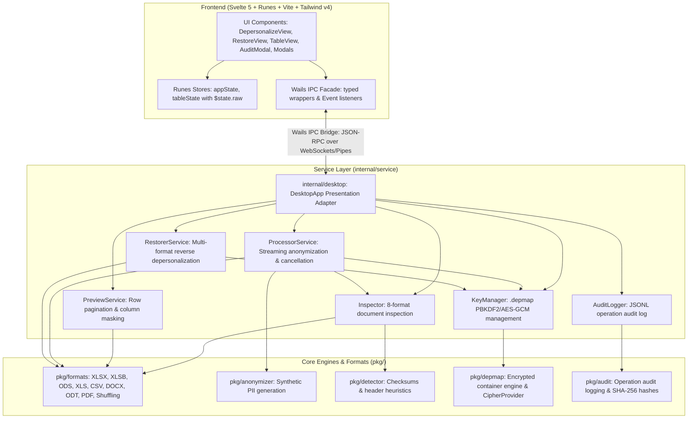

# Архитектура системы: Деперсонализация ПД (152-ФЗ)

Техническое описание архитектуры, алгоритмов, структур данных и криптографических протоколов кроссплатформенного приложения локального обезличивания и обратной персонализации данных в соответствии с требованиями 152-ФЗ РФ и Приказа Роскомнадзора от 19.06.2025 № 140.

---

## 1. Архитектурный обзор

Приложение построено на базе фреймворка **Wails v2** и языка **Go (1.23+)** с нативным биндингом к системным движкам WebView (WebKit2GTK в Linux, WebKit/WKWebView в macOS, WebView2 в Windows). 



### Принципы проектирования:
1. **Чистая архитектура (Clean Architecture)**: Полное разделение UI/Wails адаптера (`internal/desktop`), сервисов бизнес-логики (`internal/service`), доменных сущностей (`internal/domain`) и низкоуровневых процессоров (`pkg/`). Любой сервис может быть протестирован автономно без запуска WebView.
2. **Мгновенная отмена (Context Cancellation)**: Долгосрочные операции (потоковое обезличивание, инспекция, восстановление) поддерживают прерывание пользователем в 1 клик через `context.Context` с безопасным закрытием дескрипторов и удалением незавершенных файлов.
3. **Строгий Air-Gapped режим**: Приложение не открывает сетевых слушающих портов наружу, не выполняет внешних HTTP/DNS-запросов и не использует внешние CDN. Все графические ресурсы и стили встроены в исполняемый файл через директиву `//go:embed all:dist`.
4. **Высокая производительность UI**: Использование `$state.raw` в Svelte 5 для коллекций предпросмотра строк исключает оверхед глубокого проксирования на больших объемах данных.
5. **Потоковая обработка (Streaming I/O) и контроль памяти**: Обработка и обратное восстановление больших файлов (включая Excel `.xlsx`) выполняются чанками и строковыми потоками через `excelize.StreamWriter` с минимальным потреблением оперативной памяти (<100 МБ даже на файлах из сотен тысяч строк). По завершении операций вызываются `goruntime.GC()` и `debug.FreeOSMemory()`, гарантируя полный возврат физической памяти операционной системе.
6. **Ссылочная целостность (Referential Integrity)**: Синтетические данные генерируются псевдослучайно, но строго детерминировано на основе `HMAC-SHA256(исходное_значение, соль)`.
7. **Неинвазивная обратимость (Reversibility via `.depmap`)**: Обратная персонализация не требует изменения бизнес-логики генераторов; соответствия вычисляются стриминговым сравнением входа и выхода и упаковываются в зашифрованный файл-контейнер.
8. **Нормативное соответствие Приказу РКН от 19.06.2025 № 140**: автоматическая фиксация каждого факта деперсонализации и деобезличивания с расчетом хэшей SHA-256 в структурированном локальном журнале `audit.jsonl`; поддержка метода перемешивания строк (Shuffling, п. 13) для предотвращения косвенной деанонимизации; обязательное шифрование ключей `.depmap` стойким паролем с исключением создания ключей без пароля.
9. **Стратегии обработки**: поддержка трёх стратегий — DLP-Safe семантических токенов (`StrategySemanticTokens`), синтетической псевдонимизации со ссылочной целостностью (`StrategySynthetic`) и гарантированного затирания фиксированным маркером `[УДАЛЕНО]` (`StrategyDelete`) для всех поддерживаемых форматов.
10. **DLP-Safe токенизация для нейросетей**: генерация уникальных строго типизированных токенов вида `[ФИО_0001]`, `[Паспорт_0001]`, `[СНИЛС_0001]`, исключающих ложные срабатывания корпоративных DLP-систем и шлюзов при передаче данных внешним LLM.
11. **Бескоординатное восстановление (Coordinate-Free Restoration Engine)**: точное обратное восстановление данных даже при сортировке строк, перестановке колонок или включении токенов в текстовые комментарии LLM (`«Премировать [ФИО_0001]»` -> `«Премировать Иванов Иван Иванович»`).
12. **Расширенная кросс-форматность и аутентичность форматов**: поддержка 10 форматов, включая `.xlsx`, `.xlsb`, `.ods`, `.xods` (МойОфис), `.xls`, `.csv`, `.tsv`, `.docx`, `.odt`, `.txt` и `.pdf`. Сохранение файлов осуществляется строго в аутентичных форматах с сохранением структуры книг, листов, формул и стилей, а также возможностью прозрачной конвертации устаревших бинарных (.xls, .xlsb) и открытых таблиц (.ods) в современный стандарт OpenXML (.xlsx).
13. **Fail-Safe защита от OOM и лимиты размера**: гарантированная стабильность рабочей станции при загрузке сверхбольших файлов: специализированный лимит размера файла для PDF (`domain.MaxPDFInteractiveFileSize = 100 MB`, `domain.MaxBase64PreviewFileSize = 100 MB`), ограничение на распаковку потоков PDF (`io.LimitReader` 20 МБ) и полноценный рендеринг всех страниц документа в пределах допустимого размера файла без искусственного усечения. Для табличных форматов (CSV, TSV, XLSX, XLSB, ODS, XLS) и текстовых документов искусственный лимит в 100 МБ снят: они обрабатываются потоково (streaming I/O) с низким потреблением памяти (<100 МБ RAM даже на выгрузках в сотни мегабайт).
14. **Сохранение типографики и стилей DOCX в предпросмотре**: глубокое извлечение атрибутов форматирования абзацев и фрагментов (`<w:rPr>`, `<w:pPr>`, `<w:jc>`, `<w:ind>`) с точным воспроизведением начертания (жирный, курсив, подчеркивание, зачеркивание, выравнивание) и отступов в веб-интерфейсе.
15. **Отзывчивый UI и индикация парсинга тяжелых файлов**: при инспекции объемных таблиц (например, `.xlsx` 10+ МБ) интерфейс немедленно активирует анимированный индикатор загрузки со статусными бейджами этапов (распаковка структуры, эвристика заголовков, проверка контрольных сумм СНИЛС/ИНН/карт) и пульсирующим статусом в шапке, обеспечивая непрерывную визуальную обратную связь на низкопроизводительных офисных ПК.
16. **Универсальные защищённые паролем ZIP-архивы для email-отправки**: опциональная упаковка деперсонализированного документа в архив `.zip` со стандартным шифрованием PKWARE (`zip.StandardEncryption` / ZipCrypto) для безопасной отправки внешним адресатам по электронной почте в обход блокировок корпоративных шлюзов безопасности и почтовых DLP-систем; нативная распаковка штатным Проводником Windows («Извлечь всё»), macOS Archive Utility и Linux `unzip` без требования сторонних утилит.


---

## 2. Компоненты системы

### 2.1. Пакет `pkg/detector` (Распознавание ПДн)
Отвечает за проверку контрольных сумм и синтаксический анализ колонок:
- `ValidateSNILS(cleanDigits string) bool`: Проверка 11-значного СНИЛС по официальному алгоритму модуля 101 с весовыми коэффициентами `[9, 8, 7, 6, 5, 4, 3, 2, 1]`.
- `ValidateINN12(cleanDigits string) bool`: Проверка 12-значного ИНН физического лица по двум контрольным числам с официальными коэффициентами ФНС РФ:
  - $K_{11} = [7, 2, 4, 10, 3, 5, 9, 4, 6, 8] \pmod{11} \pmod{10}$
  - $K_{12} = [3, 7, 2, 4, 10, 3, 5, 9, 4, 6, 8] \pmod{11} \pmod{10}$
- `ValidateCardLuhn(cleanDigits string) bool`: Проверка контрольной суммы номера банковской карты по алгоритму Луна (Luhn mod 10).
- `ValidateCardNumber(text string) bool`: Комплексная валидация банковских карт: очистка разделителей, проверка длины (13, 15, 16, 18, 19 цифр), проверка соответствия IIN/BIN префиксам платежных систем («МИР», Visa, Mastercard/Maestro, UnionPay, American Express) и подтверждение контрольной суммы по алгоритму Луна. Исключает ложные срабатывания на технические 16-значные ID.
- `FindHeaderRow(rows [][]string) (headerIndex int, headers []string)`: Эвристический анализатор шапки таблицы, устойчивый к пустым строкам, метаданным выгрузки и сложным преамбулам.
- **Поддержка дискретных сущностей**:
  - `EntityFIO` ("FIO"), `EntityLastName` ("LAST_NAME"), `EntityFirstName` ("FIRST_NAME"), `EntityPatronymic` ("PATRONYMIC") для раздельной деперсонализации элементов ФИО.
  - `EntityAddress` ("ADDRESS"): Адреса регистрации, фактического проживания, города и регионы РФ.
  - `EntityGrade` ("GRADE"): Грейды должностей и квалификационные разряды.
  - `EntityEmployeeID` ("EMPLOYEE_ID"): Персональные табельные номера сотрудников.
- **Глубокий анализ содержимого ячеек (Deep Content Inspection)**:
  - `DetectColumnTypeWithSamples(header string, samples []string)`: Автоматически классифицирует типы данных по значениям в ячейках (почтовые индексы, адреса, даты, СНИЛС, ИНН, паспорта, ФИО) и дисквалифицирует ложные срабатывания (например, иерархические организационные коды или должности, содержащие слово «Имя»).

### 2.2. Пакет `pkg/anonymizer` (Трансформации и синтез)
Отвечает за генерацию реалистичных псевдонимизированных данных:
- **Сохранение пола (Gender Preservation)**: Функция `DetectGender(text)` анализирует окончания как составных ФИО, так и отдельных фамилий (`-ов`/`-ова`, `-ев`/`-ева`, `-ин`/`-ина`), имён (`-ий`/`-ия`, `-ей`, `-а`/`-я`) и отчеств (`-ович`/`-овна`, `-евич`/`-евна`). Мужские профили заменяются строго на мужские, женские — на женские.
- **Генерация компонентов ФИО**:
  - `GenerateFIO(seed, gender)`: Генерация полного 3-составного ФИО.
  - `GenerateLastName(seed, gender)`: Генерация одиночной фамилии.
  - `GenerateFirstName(seed, gender)`: Генерация одиночного имени.
  - `GeneratePatronymic(seed, gender)`: Генерация одиночного отчества.
- **Генерация адресов (`GenerateAddress`)**: Детерминированная замена персональной части адреса (улица, дом, корпус, квартира) с сохранением формата (полный адрес, только город или только субъект РФ).
- **Генерация грейдов (`GenerateGrade`)**: Детерминированное безопасное смещение числовых или буквенно-числовых грейдов.
- **Генерация табельных номеров (`GenerateEmployeeID`)**: Детерминированная псевдонимизация с полным сохранением исходной длины и разделителей номера.
- **Генерация СНИЛС (`GenerateSNILS`)**: Формирует 9 псевдослучайных цифр и динамически рассчитывает корректный двухзначный остаток контрольной суммы.
- **Генерация ИНН (`GenerateINN12`)**: Формирует 10 цифр и рассчитывает обе контрольные суммы для 11-го и 12-го разрядов.
- **Генерация карт «МИР» (`GenerateCardMIR`)**: Генерирует 16-значный номер карты с национальным префиксом `2200`, удовлетворяющий алгоритму Луна (Luhn mod 10).
- **Сдвиг дат (`PerturbDate`)**: Смещает дату рождения в диапазоне $\pm N$ дней с сохранением года или реалистичного возрастного интервала.

### 2.3. Пакет `pkg/depmap` (Криптоконтейнер `.depmap`)
Обеспечивает безопасное хранение словаря соответствий деперсонализации для выполнения обратной операции.

#### Структура бинарного файла `.depmap`:
```
+------------------+------------------+------------------+-----------------------------+
| Magic (8 байт)   | KDF Salt (16 б.) | GCM Nonce (12 б.)| Encrypted Ciphertext + Tag  |
| "DEPMAP01"       | crypto/rand      | crypto/rand      | (AES-256-GCM + ZLIB JSON)   |
+------------------+------------------+------------------+-----------------------------+
```

1. **Заголовок (Magic)**: 8 байт `DEPMAP01` для строгой идентификации типа файла и версии протокола.
2. **KDF Salt**: 16 криптографически стойких случайных байт (`crypto/rand`).
3. **GCM Nonce**: 12 уникальных байт инициализирующего вектора для режима Galois/Counter Mode.
4. **Формирование ключа шифрования и интерфейс CipherProvider**:
   - Интерфейс криптопровайдера `CipherProvider`:
     ```go
     type CipherProvider interface {
         Encrypt(plaintext []byte, password string) ([]byte, error)
         Decrypt(ciphertext []byte, password string) ([]byte, error)
     }
     ```
   - Стандартная реализация `AES256GCMProvider`:
     $$\text{Key} = \text{PBKDF2}(\text{password}, \text{salt}, 100\,000, 32, \text{SHA256})$$
   - При сохранении новых файлов `.depmap` обязателен пользовательский или сгенерированный стойкий пароль (создание ключей без пароля заблокировано).
   - **Политика надежности паролей (`pkg/depmap/policy.go`)**:
     - Минимальная длина: не менее 12 символов;
     - 4 обязательных класса символов строго латиницы: заглавные буквы (`A–Z`), строчные буквы (`a–z`), цифры (`0–9`) и специальные символы (`!@#$%^&*()_+-=[]{}|;:,.<>?`); кириллица, пробелы и не-ASCII символы исключены во избежание опечаток, проблем с раскладками клавиатуры и гомоглифами;
     - Функция `EvaluatePasswordStrength(password)` рассчитывает числовую надежность (0–4) и детализированную структуру критериев `PasswordPolicyDetails` (включая проверку `OnlyLatin`) для визуализации в UI;
     - Генератор `GenerateRandomPassword(length)` использует `crypto/rand`, гарантируя включение всех 4 классов символов с криптографическим перемешиванием Фишера — Йетса;
     - Валидация выполняется синхронно на уровне бэкенда (`ValidatePassword`) и проверяется перед запуском процесса сохранения.
   - Встроенный мастер-ключ приложения сохранен исключительно в режиме дешифрования для обратной совместимости с ранее созданными файлами.
5. **Тело контейнера**:
   - Словарь замен и метаданные сериализуются в JSON:
     ```json
     {
       "version": 1,
       "created_at": "2026-10-09T12:00:00Z",
       "original_file": "clients.xlsx",
       "records_count": 1420,
       "mode": "delete",
       "mapping": {
         "Смирнов Алексей Петрович": "Иванов Иван Иванович"
       },
       "cell_mappings": {
         "Лист1:ФИО:2": "Иванов Иван Иванович",
         "Лист1:СНИЛС:2": "112-233-445 95"
       },
       "target_headers": ["ФИО", "СНИЛС", "Телефон"],
       "ordinal_mappings": ["Иванов Иван Иванович", "112-233-445 95"]
     }
     ```
   - **Поля структуры DepMap**:
     - `mode`: режим выполнения операции — `"replace"` (детерминированная замена) или `"delete"` (удаление с маркером `[УДАЛЕНО]`).
     - `mapping`: словарь соответствий `синтетическое_значение -> исходное` для режима замены.
     - `cell_mappings`: ассоциативный массив точечных координат `"{Sheet}:{Header}:{PhysicalRow}" -> исходное_значение` для таблиц в режиме удаления. Обеспечивает точный возврат исходных значений без коллизий.
     - `target_headers`: срез канонических наименований колонок, подвергшихся обезличиванию. Используется для **Header-Aware** сопоставления при обратном восстановлении.
     - `ordinal_mappings`: упорядоченный список исходных сущностей для документов со сплошным текстом (Word/ODT), обработанных в режиме удаления.
   - JSON сжимается алгоритмом `zlib` (максимальное сжатие).
   - Сжатые данные шифруются **AES-256-GCM** с добавлением 16-байтовой имитовставки (Auth Tag).
6. **Права доступа**: Файл создаётся с маской разрешений `0600` (`-rw-------`), запрещая чтение другим пользователям операционной системы.

### 2.4. Пакет `pkg/formats` (Форматные процессоры)

#### Обработка и восстановление Excel (`excel_handler.go`, `restore_excel.go`)
- Построена на базе высокопроизводительной библиотеки `github.com/xuri/excelize/v2`.
- В режиме деперсонализации используется потоковый интерфейс `StreamWriter` для минимизации аллокаций памяти.
- В режиме «Удаление» (`ModeDelete`) ячейки заполняются маркером `[УДАЛЕНО]`, а точные привязки сохраняются в `CellMappings` и `TargetHeaders` ключа `.depmap`.
- В режиме восстановления (`RestoreExcel`) файл открывается по листам:
  - **Header-Aware сопоставление**: строка заголовков сопоставляется с `TargetHeaders` и ключами `CellMappings`. При добавлении внешними нейросетями (LLM) или аналитиками новых колонок в любые позиции таблицы, индексы колонок динамически разрешаются по именам заголовков.
  - Итератор `GetRows` считывает ячейки.
  - Изменения накапливаются в структуре `[]cellChange{Cell: "B12", Value: "..."}`.
  - Применение изменений через `SetCellValue` выполняется после закрытия курсора чтения, что гарантирует сохранение формул, ширины колонок, стилей и структуры книги.
  - **Любые дополнительные столбцы** (добавленные LLM или подрядчиками: `Score`, `Cluster`, `AI_Summary`) остаются нетронутыми.

#### Обработка и восстановление CSV (`csv_handler.go`, `restore_csv.go`)
- Автоматически распознаёт разделители: `,` (запятая), `;` (точка с запятой), `\t` (табуляция).
- Поддерживает прозрачную очистку UTF-8 BOM (`\xef\xbb\xbf`) и сохранение формата кавычек.
- В режиме удаления ячейки заменяются на `[УДАЛЕНО]`, а маппинги фиксируются в `CellMappings` (`":Header:Row"`).
- Header-Aware восстановление динамически сопоставляет заголовки CSV со списком `TargetHeaders`, надежно восстанавливая данные даже при добавлении новых колонок LLM.
- Потоковое чтение и запись через буферизованный ввод-вывод (`bufio.Reader`, `bufio.Writer`).

#### Обработка и восстановление текстовых документов Word и OpenDocument (`docx_handler.go`, `odt_handler.go`, `restore_docx.go`, `restore_odt.go`)
- В режиме «Удаление» (`ModeDelete`) обнаруженные сущности в параграфах и таблицах заменяются на маркер `[УДАЛЕНО]`.
- Исходные фрагменты последовательно сохраняются в `OrdinalMappings` файла-ключа `.depmap`.
- Обратное восстановление последовательно считывает маркеры `[УДАЛЕНО]` и восстанавливает исходные значения строго в порядке их появления в документе без скачков и коллизий.

#### Вымарывание и предпросмотр в PDF (`pdf_handler.go`, `PdfPreview.svelte`)
- **Универсальный предпросмотр на базе Mozilla `pdfjs-dist` (100% Air-Gapped)**:
  - Фронтенд получает бинарные данные документа через Wails API `GetFileBase64` и передает их в изолированный локальный Web Worker (`frontend/src/lib/utils/pdfWorker.ts`).
  - Все страницы документа рендерятся в едином скролл-контейнере со сплошной вертикальной лентой листов формата А4 с поддержкой масштабирования HiDPI / Retina (`window.devicePixelRatio`).
  - Движок PDF.js извлекает нормализованный текстовый слой (`getTextContent()`), устраняя искажения составных шрифтов `/Type0` (`/Identity-H`) и разрывы межбуквенного кернинга.
  - Поверх холста накладываются интерактивные плашки в стиле Word (`TextPreview.svelte`) с переключением между «Обезличенным видом» и «Исходным видом».
  - Поддерживается **поточечное (Per-Instance)** исключение сокрытия: оператор может кликом снять цензурирование с конкретного экземпляра ПДн (например, открытые реквизиты директора).
- **Гарантированное физическое векторное цензурирование по координатам (Blackout Redaction)**:
  - При сохранении документа точные координаты активных плашек `[{Page, X, Y, Width, Height}]` передаются в Go-бэкенд через `ProcessFileWithOptions` (`PDFRedactionBoxes`).
  - В обработчике `pdf_handler.go` (`redactContentStream`):
    - Векторные черные непрозрачные прямоугольники (`q 0 0 0 rg X Y W H re f Q`) накладываются точно на физические координаты текста (в стандартной 72 DPI системе координат PDF).
    - Текст под плашками физически вырезается из контентных потоков: исходные глифы заменяются на пробельные CID составных шрифтов, сохраняя горизонтальное позиционирование и исключая копирование или OCR.
    - Пересчитывается таблица перекрёстных ссылок (`xref`) и трейлер документа.
- **Быстрое бэкенд-извлечение метаданных и текстового слоя (`ExtractPDFRawTextAndPageCount`)**:
  - Распаковывает сжатые контентные потоки FlateDecode (`/Filter /FlateDecode`), графические формы XObject (`/Subtype /Form`) и CMap `/ToUnicode`.
  - Извлекает количество страниц и плоский текст для быстрого первичного инспектирования сущностей (СНИЛС, паспорта, ИНН, телефоны) и формирования текстовой выжимки `PDFTextSnippet` без накладных эвристических расходов.

#### Перемешивание строк (`shuffle.go`)
- Реализация алгоритма тасования Фишера-Йетса с использованием криптографически стойкого источника случайных чисел (`crypto/rand`).
- Применяется при экспорте электронных таблиц (`.xlsx`, `.ods`, `.csv`) при включении опции `shuffleRows` (строка заголовков сохраняется на первой позиции).
- Для нетабличных форматов (`.docx`, `.odt`, `.txt`, `.pdf`) опция принудительно отключена в UI и игнорируется в сервисном процессоре во избежание нарушения связности разделов документа.
- Соответствует п. 13 Приказа Роскомнадзора от 19.06.2025 № 140 для противодействия косвенной деанонимизации по исходному порядку следования записей.

#### Распознавание колонок, трансформация и выбор режима (`columns.go`)
- Функция `DetectColumnTypeWithSamples(header, sampleValues)` комбинирует анализ заголовка с проверкой фактических значений ячеек регулярными выражениями:
  - Выявление email-адресов в произвольных колонках (`Логин`, `Учетная запись` и др.).
  - Разделение столбцов на `ColLastName`, `ColFirstName`, `ColPatronymic` при индивидуальных заголовках.
- Функция `ProcessCell(anon, colType, val, mode, dateRange)` осуществляет маршрутизацию:
  - При `mode == domain.ModeDelete`: подставляет `DeletionMarker` (`"[УДАЛЕНО]"`).
  - При `mode == domain.ModeReplace`: обращается к детерминированному синтезу `AnonymizeCell`.

#### Мультиформатный предпросмотр (`internal/service/preview/preview.go`)
- Унифицированный интерфейс постраничной выборки `GetSheetRows`:
  - Нативная постраничная выборка строк для всех поддерживаемых табличных форматов: `.xlsx`, `.xls`, `.xlsb`, `.ods`, `.csv`.
  - Поддержка параметра `mode` («replace» или «delete») с динамическим пересчетом значений строк на лету без перезаписи исходного файла.

### 2.5. Пакет `pkg/audit` (Журнал учета операций по Приказу РКН № 140)
Обеспечивает непрерывный локальный аудит всех операций деперсонализации и деобезличивания данных в соответствии с требованиями Приказа Роскомнадзора от 19.06.2025 № 140:
- **Структура записи `AuditRecord`**:
  ```go
  type AuditRecord struct {
      Timestamp    string   `json:"timestamp"`
      Username     string   `json:"username"`
      Hostname     string   `json:"hostname"`
      Operation    string   `json:"operation"`     // "depersonalize" или "restore"
      Mode         string   `json:"mode,omitempty"` // "replace" или "delete"
      SourceFile   string   `json:"source_file"`
      SourceHash   string   `json:"source_hash"`   // SHA-256 исходного файла
      ResultFile   string   `json:"result_file"`
      ResultHash   string   `json:"result_hash"`   // SHA-256 сохраненного файла
      RecordsCount int      `json:"records_count"`
      Entities     []string `json:"entities,omitempty"`
      KeyCreated   bool     `json:"key_created"`
      Status       string   `json:"status"`        // "success", "canceled" или "error"
      Error        string   `json:"error,omitempty"`
  }
  ```
- **Локальное хранение**: Записи добавляются в конец структурированного файла `~/.depersonalizer/audit.jsonl` (JSON Lines) с потоковой синхронизацией на диск (`O_APPEND|O_CREATE|O_WRONLY`).
- **Контроль целостности**: Автоматический расчет контрольных сумм по алгоритму SHA-256 до и после обработки подтверждает неизменность исходных данных и корректность результирующего файла.
- **Интеграция с UI**:
   - `GetRecentEntries(limit int)`: возвращает последние N записей (по умолчанию 50) для быстрого рендеринга в модальном окне журнала.
   - `Export(destPath string)`: атомарно копирует файл журнала в указанное пользователем место для передачи регуляторам.

### 2.6. Пакет `pkg/ziputil` (Защищённые паролем ZIP-архивы)
Обеспечивает формирование универсальных зашифрованных ZIP-архивов для безопасной отправки деперсонализированных файлов по электронной почте:
- **Универсальная кроссплатформенная совместимость**:
  - Использует библиотеку `github.com/yeka/zip` с алгоритмом `zip.StandardEncryption` (PKWARE Traditional Encryption / ZipCrypto).
  - В отличие от проприетарного WinZip AES-256 (который требует наличия 7-Zip или сторонних утилит и не открывается встроенными средствами во многих версиях Windows и macOS), архивы ZipCrypto распаковываются штатным проводником Windows («Извлечь всё»), стандартной утилитой архивов macOS (Archive Utility), командой Linux `unzip -P` и мобильными ОС без установки дополнительного ПО.
- **Атомарность и безопасность создания**:
  - `CreatePasswordZip(srcFilePath, destZipPath, password string) error`: создает архив через временный файл `.tmp` с атомарным переименованием (`os.Rename`), исключая появление поврежденных архивов при сбоях.
  - В архив упаковывается исключительно сам файл данных с сохранением его исходного базового имени; файл-ключ `.depmap` в архив не включается.
- **Политика валидации паролей архива**:
  - `ValidateArchivePassword(password string) error`: проверяет минимальную длину (не менее 4 символов), принадлежность символов к диапазону печатаемых символов ASCII (`0x21`–`0x7e`) и отсутствие пробелов. Это гарантирует отсутствие коллизий кодировок (UTF-8 против OEM CP866/CP1251) в штатных архиваторах различных версий ОС.
- **Генерация стойких паролей**:
  - Функция генератора использует криптостойкий источник `crypto/rand` и набор `[a-zA-Z0-9!@#$%^&*()_+-=]`, создавая 16-значные пароли для быстрой вставки.

---

## 3. Взаимодействие компонентов (IPC Wails)

Связь между фронтендом Svelte 5 и адаптером Go осуществляется через типизированный фасад `frontend/src/lib/api/wails.ts` и IPC-мост Wails:

| Метод Wails Go | Аргументы | Назначение |
|---|---|---|
| `GetAppInfo` | `()` | Возвращает ОС (`macOS`, `ALT Linux 10.4`, `Windows`), архитектуру и версию |
| `SelectFile` | `()` | Открывает нативный системный диалог выбора документов (все 8 форматов) |
| `SelectKeyFile` | `()` | Открывает системный диалог выбора файлов-ключей (`*.depmap`) |
| `SaveFileDialog` | `(defaultName)` | Открывает диалог сохранения обработанного документа |
| `SaveKeyFileDialog` | `(defaultName)` | Открывает диалог сохранения ключа восстановления `.depmap` |
| `SaveArchiveFileDialog` | `(defaultName)` | Открывает диалог сохранения защищённого ZIP-архива |
| `InspectFile` | `(path)` | Анализирует структуру файла, находит шапку и категории ПДн |
| `GetTableRows` | `(path, offset, limit, salt, disabledCols)` | Динамическая подгрузка строк для бесконечного скролла таблицы |
| `GetSheetRows` | `(path, sheet, offset, limit, salt, disabledCols, mode)` | Подгрузка строк конкретного листа с учетом режима (replace/delete) |
| `ProcessFile` | `(path, salt, mode...)` | Быстрое обезличивание в файл по умолчанию |
| `ProcessFileTo` | `(path, outPath, salt, disabledCols, createKey, password, keyPath, shuffleRows, mode...)` | Обезличивание с выбором режима, исключением колонок, защищенным ключом и перемешиванием строк |
| `ProcessFileWithSheets` | `(path, outPath, salt, disabledCols, disabledBySheet, createKey, password, keyPath, shuffleRows, mode...)` | Пакетное обезличивание многостраничных книг с раздельными колонками, режимом и перемешиванием строк |
| `ProcessFileWithOptions` | `(options)` | Обезличивание с расширенными опциями, включая параметры защищённого ZIP-архива и точные координаты рамок сокрытия `pdfRedactionBoxes` |
| `GetFileBase64` | `(path)` | Безопасное чтение локального файла и возврат содержимого в формате Base64 для офлайн-рендеринга в PDF.js |
| `CancelCurrentOperation` | `()` | **Мгновенная отмена текущей операции** (потока деперсонализации или восстановления) |
| `InspectKeyFile` | `(keyPath, password)` | Проверка валидности контейнера `.depmap` и чтение метаданных |
| `RestoreFileTo` | `(inputPath, keyPath, password, destPath)` | Обратная персонализация документа по ключу `.depmap` (с Header-Aware сопоставлением) |
| `OpenContainingFolder` | `(path)` | Открывает папку с файлом в Finder / Explorer / Nautilus |
| `GetAuditLog` | `()` | Возвращает последние 50 записей локального журнала учета операций (Приказ РКН № 140) |
| `ExportAuditLogDialog` | `()` | Открывает диалог экспорта полного журнала аудита в файл `.jsonl` |
| `GenerateSecurePassword` | `()` | Генерирует криптостойкий 16-значный случайный пароль для ключа `.depmap` |
| `GenerateArchivePassword` | `()` | Генерирует криптостойкий 16-значный пароль для защищённого ZIP-архива |
| `ValidateArchivePassword` | `(password)` | Проверяет соответствие пароля архива требованиям (ASCII, min 4 символа, без пробелов) |

### События (Wails Events):
- `process-progress`: `{ "processed": 1500, "total": 8500, "percent": 17 }`
- `restore-progress`: `{ "processed": 320, "total": 1420, "percent": 22 }`
- `app:file-dropped`: Эмитится при перетаскивании файла из операционной системы в окно программы (с автоматическим определением режима).

---

## 4. Сборка под различные платформы

Процесс кросс-компиляции описан в `Makefile`:

### 1. Alt Linux 10.4 (Docker)
```bash
make build-altlinux
```
Использует контейнер `alt:p10` архитектуры `linux/amd64` с нативно установленными пакетами `gcc`, `golang`, `libwebkit2gtk-devel`, `libgtk+3-devel`. Гарантирует привязку к системной `glibc 2.32` отечественного дистрибутива.

### 2. macOS Universal Binary (.app Bundle)
```bash
make build-macos
```
Собирает две независимые версии (`darwin/arm64` под Apple Silicon и `darwin/amd64` под Intel) с флагами связывания `-framework UniformTypeIdentifiers`, объединяет их через утилиту `lipo -create` в единый универсальный файл, после чего формирует полноценный бандл `Depersonalizer.app` с иконкой `icon.icns`.

### 3. Windows x86_64
```bash
make build-windows
```
Генерирует Windows PE-ресурсы `.syso` (`build/tools/build_syso.go`) со встроенной иконкой приложения, после чего использует кросс-компиляцию Go (`GOOS=windows GOARCH=amd64`) с флагом `-H windowsgui` для подавления окна командной строки при запуске GUI.

---

## 5. Архитектура UI на Svelte 5 (Runes) и рендеринг таблиц

Интерфейс приложения построен на **Svelte 5** с использованием системы рун (**Runes**):

### 5.1 Реактивное состояние больших данных (`$state.raw`)
Для эффективной работы с электронными таблицами объемом в десятки тысяч строк стандартное глубокое реактивное оборачивание (Deep Proxy) неприемлемо из-за оверхеда по памяти и скорости.
- В `frontend/src/lib/stores/tableState.svelte.ts` массив строк хранится в руне `$state.raw<PreviewRow[]>`:
  - Мутации строк происходят без проксирования отдельных ячеек.
  - При подгрузке новых порций создается новый массив (`rows = [...rows, ...newRows]`), что гарантирует атомарный и высокоскоростной рендеринг.
- Служебное состояние (ширины колонок, флаги загрузки, пагинация, активный лист) управляется рунами `$state`:
  - `columnWidths = $state<Record<number, number>>({})` хранит текущие ширины столбцов в пикселях.
  - `hasMoreRows = $derived(rows.length < totalRows)` вычисляет доступность дальнейших страниц.

### 5.2 Интерактивный ресайз колонок и фиксированная верстка
Для предсказуемого отображения таблицы при любых объемах данных и текста в ячейках:
- Применена фиксированная верстка таблицы `.resizable-table` (`table-layout: fixed; width: 100%`).
- Ширины колонок задаются через `<col>` теги в блоке `<colgroup>` на основе карты `columnWidths`.
- При первой загрузке файла ширины автоматически рассчитываются под длину текста заголовка и бейджей замены с учетом минимальной границы (110–130px).
- Интерактивный разделитель `.col-resizer` перехватывает события мыши (`pointerdown`, `pointermove`, `pointerup` с `setPointerCapture`), гарантируя плавное перетаскивание даже за пределами заголовка таблицы.
- Текст ячеек снабжен обрезкой с многоточием (`truncate`), что позволяет сжимать столбцы до компактных размеров без поломки соседних ячеек.

### 5.3 Динамический бесконечный скролл (Infinite Scroll)
В модальном окне полноэкранного предпросмотра:
- При достижении скроллом нижней границы контейнера (порог 60px) триггерится метод `loadMoreRows()`.
- Строки запрашиваются у бэкенда порциями по 30 штук (`GetTableRows` / `GetSheetRows`).
- Внедрен флаг `loadingMoreRows` для защиты от параллельных или повторных вызовов во время сетевого ожидания.

### 5.4 Подсистема масштабирования интерфейса (`zoomState.svelte.ts`)
Для адаптации под различные разрешения экранов (включая HiDPI / 4K) и пользователей со слабым зрением:
- Реактивное состояние в `frontend/src/lib/stores/zoomState.svelte.ts` управляет коэффициентом масштабирования `currentZoom` в диапазоне от `0.70` (70%) до `2.00` (200%).
- Масштабирование применяется аппаратно через нативное свойство CSS `zoom` на элементе `document.documentElement`, что сохраняет векторную четкость шрифтов, пиктограмм и целостность сеток Tailwind.
- События `wheel` (с проверкой `ctrlKey || metaKey`) перехватывают жест прокрутки мыши с вызовом `preventDefault()` для подавления нежелательного вертикального скролла окна.
- Поддерживаются стандартные горячие клавиши (`Ctrl/Cmd + / - / 0`) и кнопки в шапке `Header.svelte`.
- Выбранный коэффициент масштабирования автоматически сохраняется в `localStorage['dep_app_zoom']` и восстанавливается при запуске приложения.

### 5.5 Дизайн-система и кинетика интерфейса (Apple Fluid Dynamics & Linear/Notion Minimalism)
В соответствии с современными стандартами интерактивного дизайна интерфейс спроектирован как высокоточный, тактильно отзывчивый инструмент:
- **Кинетические переменные и тайминги (`app.css`)**:
  - Фирменная кривая затухания Apple: `--ease-apple-fluid: cubic-bezier(0.16, 1, 0.3, 1)`.
  - Тактильная кривая нажатия: `--ease-apple-press: cubic-bezier(0.2, 0.8, 0.2, 1)`.
  - Микро-тайминги: 120 мс для тактильных нажатий и наведения, 180 мс для раскрытия элементов, 260 мс для модальных поверхностей.
- **Тактильный микро-отклик (`.pressable`)**:
  - Физическая компрессия интерактивных кнопок (`active:scale-[0.985]`) с мгновенным обратным возвратом, создающая ощущение физического инструмента до загрузки данных.
- **Liquid Glass Navigation**:
  - Навигационная шапка и плавающие панели используют полупрозрачное матирование (`backdrop-blur-md`, `rgba(255,255,255,0.78)` в светлой теме / `rgba(24,24,27,0.85)` в темной теме) с 1px волосяной верхней каймой.
- **Пространственное появление модальных окон (`.animate-surface-enter`)**:
  - Плавное всплытие с масштабированием (`scale(0.96) -> scale(1)`) и затуханием прозрачности (`0 -> 1`) за 240 мс без баунс-эффектов.
- **Векторная микро-анимация (SVG Checkmark)**:
  - Рисование контура галочки подтверждения пароля через SVG `stroke-dashoffset` (`.checkmark-path`).
- **Строгий минимализм и отсутствие шума**:
  - Контролируемые радиусы скругления 6–8px (crisp geometry).
  - Монохромная нейтральная палитра с единственным функциональным акцентным цветом (изумрудным).
  - Исключение круглых скобок в интерфейсном микрокопирайтинге (статусы, размеры, бейджи форматов).
- **Доступность (Accessibility)**:
  - Медиа-запрос `@media (prefers-reduced-motion: reduce)` отключает все масштабирования и анимации для пользователей с вестибулярной чувствительностью.

---

## 6. Подсистема версионирования (Semantic Versioning)

В приложении используется идиоматичный для экосистемы Go подход к версионированию:

### 6.1 Единый источник правды
- Версия определяется в пакете `internal/version/version.go`:
  ```go
  package version

  const Version = "1.13.0"
  ```
- Метод `GetAppInfo()` возвращает `v + version.Version`, отображаемый в шапке `Header.svelte`.
- Версия синхронизирована с `frontend/package.json` и `Makefile`.

### 6.2 Семантическое версионирование (SemVer)
- **PATCH (`X.Y.Z+1`)**: исправление ошибок, точечные правки стилей, текстовые фиксы.
- **MINOR (`X.Y+1.0`)**: новые возможности, новые форматы файлов, переработка экранов UI, оптимизация производительности (текущий релиз `1.13.0`).
- **MAJOR (`X+1.0.0`)**: несовместимые изменения формата контейнера `.depmap` или фундаментальные изменения протоколов.

### 6.3 Журнал изменений (`CHANGELOG.md`)
Все изменения документируются в соответствии с [Keep a Changelog 1.0.0](https://keepachangelog.com/ru/1.0.0/) в файле `CHANGELOG.md`. Обязательные правила для агентов зафиксированы в `AGENTS.md`.
