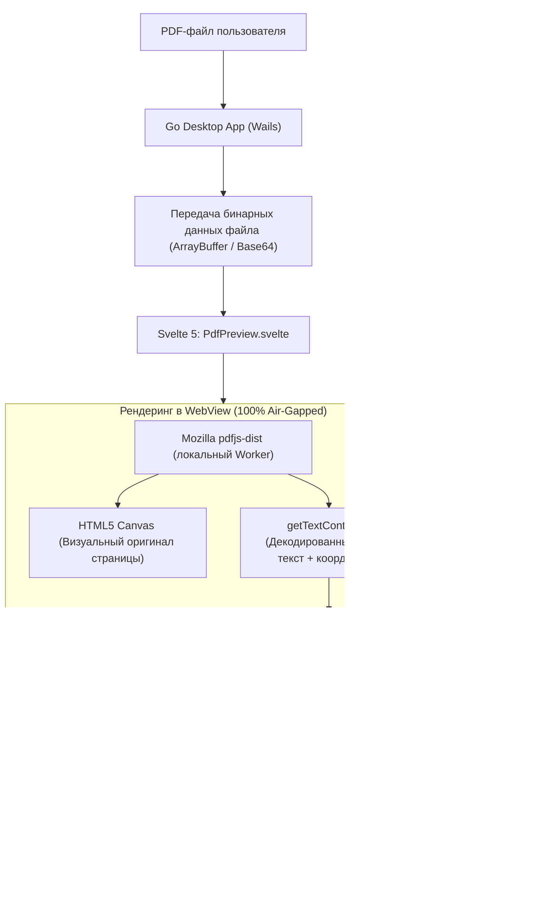

# Архитектурный дизайн: Интеграция Mozilla PDF.js для предпросмотра и обезличивания PDF

## 1. Назначение и контекст (Intent & Why)

В десктопном приложении деперсонализации (Wails v2 + Svelte 5 + Go 1.23) пользователи работают с различными типами документов (DOCX, XLSX, ODT, CSV, PDF). В то время как для Word и текстовых файлов предпросмотр работает стабильно и наглядно отображает исходный текст с интерактивными плашками ПДн, работа с PDF вызывала критические проблемы:
- В двухколоночных договорах (`forma_tipovogo_dogovora_vyezdnoe_obsluzhivanie.pdf`) текст левой и правой колонок слипался вперемешку.
- В электронных билетах (`ETICKET_PLETNEV...`) ручной кернинг/трекинг разбивал слова на разрозненные буквы с пробелами.
- В заявлениях (`Плетнёв_ЯА_Оригинал_заявления...`) нестандартные встроенные шрифты с кодировкой `Identity-H` выдавали бинарные спецсимволы вместо букв.
- В сканах (`Положение о управлении.pdf`) отсутствовал чистый текстовый слой.
- При сохранении обезличенного PDF на бэкенде плашки цензурирования не накладывались из-за несовпадения текстовых потоков.

Пользователю необходимо, чтобы **PDF отображался точно так же, как исходный оригинальный документ** (со всеми колонками, таблицами, шрифтами, бланками, сканами подписей и печатей), в виде **единой непрерывной вертикальной ленты страниц (сплошной скролл без кнопок перелистывания)**, а найденные персональные данные подсвечивались **интерактивными плашками по аналогии с Word (`TextPreview.svelte`)**: с тултипами «До»/«После», переключателем «Обезличенный / Исходный вид» и возможностью **поточечного (per-instance) отключения скрытия для конкретного места** по клику.

---

## 2. Цели, не-цели и анти-цели (Goals, Non-Goals, Anti-Goals)

### Цели (Goals):
1. **Пиксель-в-пиксель отображение:** Встроить официальный автономный движок **Mozilla `pdfjs-dist`** в Svelte 5 фронтенд для рендеринга страниц PDF на HTML5 `<canvas>` с сохранением всех шрифтов, векторных элементов, колонок и таблиц.
2. **Непрерывный вертикальный скролл:** Все страницы документа отображаются последовательно друг за другом в контейнере `#pdf-sheet-viewport` с серым фоном `#EDEBE6`, естественными отступами и тенями бумажных листов (без кнопок перелистывания страниц).
3. **Интерактивные плашки ПДн (Word-style UI):**
   - Переключатель тулбара **«Обезличенный вид»** (зеленые плашки) / **«Исходный вид»** (янтарные плашки).
   - Подсветка найденных ПДн плашками прямо поверх слов документа.
   - Всплывающий тултип при наведении на плашку (тип сущности, значение «До», значение «После», статус замены).
   - **Поточечное (per-instance) отключение:** клик по конкретной плашке отключает обезличивание только для этого одного вхождения (например, оставляет реквизиты директора, но скрывает клиента). Отключенная плашка перечеркивается и не цензурируется в итоговом файле.
   - Индикатор счетчика страниц и общего количества найденных фрагментов ПДн.
4. **100% Air-Gapped совместимость:** Пакет `pdfjs-dist` и его Web Worker бандлятся строго локально через npm/Vite. Ноль внешних HTTP-запросов, ноль обращений к CDN.
5. **Гарантированное физическое обезличивание в итоговом файле:** При нажатии «Обезличить» массив точных координат активных плашек `[{page, x, y, width, height}]` передается в Go `PDFHandler.Process`. Бэкенд рисует векторные черные прямоугольники цензурирования (`re f`) строго по этим координатам и вычищает текст, гарантируя 100% сокрытие данных по 152-ФЗ.

### Не-цели (Non-Goals):
1. Встраивание тяжелого движка OCR (Tesseract) для 100% растровых сканов без текста в этом спринте — для сканов отображается оригинальное изображение, а глубокое оптическое распознавание картинок выделяется в отдельную фичу бэклога.
2. Редактирование произвольного текста документа в режиме WYSIWYG.

### Анти-цели (Anti-Goals):
1. Запрещено использовать внешние CDN или сетевые библиотеки (строгое требование Air-Gapped).
2. Запрещено ломать или изменять логику работы других форматов (DOCX, XLSX, ODT, CSV, TXT).

---

## 3. Архитектура решения и поток данных (Architecture & Data Flow)



---

## 4. Детали реализации компонентов

### 4.1. Фронтенд (Svelte 5 + Vite):
1. **Зависимость:** Установка `pdfjs-dist` в `frontend/package.json`.
2. **Локальный Web Worker:** Импорт воркера через локальный бандл Vite:
   ```ts
   import * as pdfjsLib from 'pdfjs-dist';
   import pdfWorker from 'pdfjs-dist/build/pdf.worker.min.mjs?url';
   pdfjsLib.GlobalWorkerOptions.workerSrc = pdfWorker;
   ```
3. **Компонент `PdfPreview.svelte`:**
   - **Sticky Toolbar:**
     - Индикатор `ПРЕДПРОСМОТР ДОКУМЕНТА (PDF)`.
     - Статистика: `▪ N страниц ▪ M фрагментов ПДн`.
     - Переключатель: `[ Обезличенный вид ]` / `[ Исходный вид ]`.
   - **Viewport со сплошным скроллом:**
     - Контейнер `#pdf-sheet-viewport` с серым фоном `#EDEBE6`, вертикальный скролл.
     - Последовательный рендеринг страниц `.pdf-page-sheet` друг за другом:
       - Белый фон, тень `shadow-md`, границы `#D5D3CC`.
       - `<canvas>` с коэффициентом 2x для Retina/HiDPI.
       - Текстовый слой и оверлей плашек с абсолютным позиционированием по координатам глифов.
   - **Интерактивность плашек:**
     - Каждое вхождение имеет уникальный ключ `instanceId = `${page}_${entityIdx}``.
     - Локальное реактивное состояние `disabledInstanceIds = $state<Set<string>>(new Set())`.
     - При клике: `disabledInstanceIds` переключается только для данного экземпляра. Отключенная плашка получает класс `line-through` и отображает исходный текст.
     - При наведении курсора: всплывающий тултип (`До`, `После`, тип сущности, `💡 Кликните для отключения замены`).

### 4.2. Бэкенд (Go 1.23):
1. **Передача документа в Wails:** Метод `GetFileContent(filePath)` для загрузки байт PDF в WebView без внешних протоколов.
2. **Обезличивание по координатам (`pkg/formats/pdf_handler.go`):**
   - Метод `Process` принимает список координат цензурирования `RedactionBox { Page int, X float64, Y float64, Width float64, Height float64 }`.
   - Векторные черные прямоугольники (`0 0 0 rg`, `X Y W H re f`) накладываются в контентный поток страницы ровно по тем координатам, которые пользователь видел в превью.
   - Текст под прямоугольниками зачищается, исключая возможность выделения или копирования персональных данных.

---

## 5. Архитектурные решения, зафиксированные разработчиком (Architect's Calls)
1. **Точность детекции и кодировок:** PDF.js используется как первичный декодер текста (`getTextContent`), гарантируя 100% корректное разрешение кодировок CMap и Identity-H шрифтов, которые ломали Go-парсер.
2. **Гарантия наличия плашек в итоговом файле:** Сохранение выполняется по координатам из превью, исключая проблему «ни одной плашки нету».
3. **Производительность:** Для документов до 20 страниц рендеринг выполняется сразу; для сверхдлинных (>20 страниц) используется `IntersectionObserver` для экономии памяти GPU.
